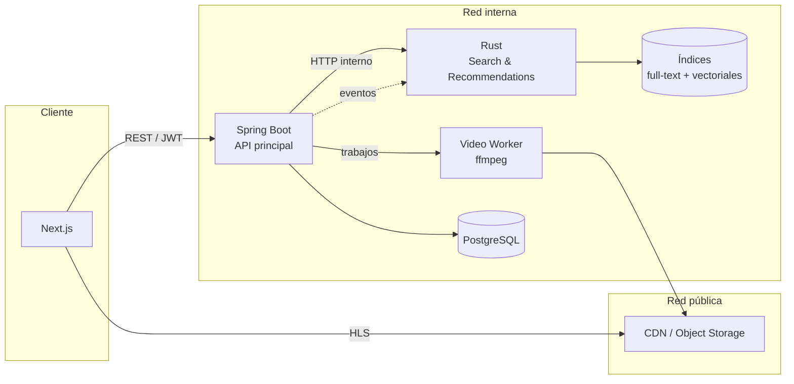
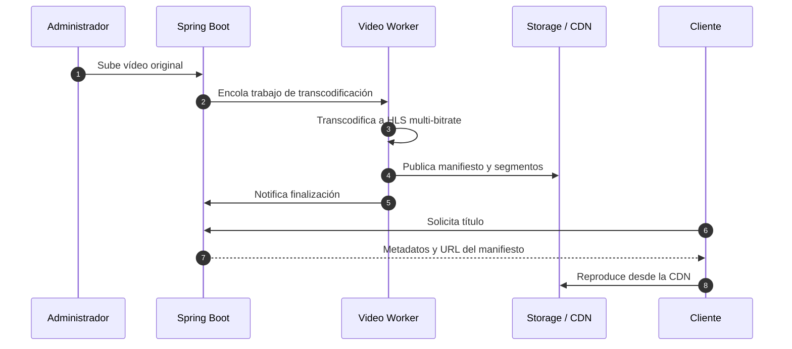

<div align="center">

# CineMatch

**Plataforma de vídeo bajo demanda con arquitectura de servicios: Spring Boot, Rust y Next.js.**


-000000?logo=rust&logoColor=white)


</div>

---

> [!NOTE]
> El proyecto se encuentra en fase de diseño. Este documento describe la arquitectura objetivo y sirve como base para la revisión del equipo. Las secciones marcadas como *planificado* aún no están implementadas.

## Tabla de contenidos

1. [Descripción](#descripción)
2. [Funcionalidades](#funcionalidades)
3. [Arquitectura](#arquitectura)
4. [Stack tecnológico](#stack-tecnológico)
   - [Versiones](#versiones)
5. [Estructura del repositorio](#estructura-del-repositorio)
6. [Servicios](#servicios)
7. [Pipeline de vídeo](#pipeline-de-vídeo)
8. [Comunicación entre servicios](#comunicación-entre-servicios)
9. [Puesta en marcha](#puesta-en-marcha)
10. [Roadmap](#roadmap)
11. [Contribución](#contribución)
12. [Cuestiones abiertas](#cuestiones-abiertas)

---

## Descripción

CineMatch es una aplicación de vídeo bajo demanda que permite a los usuarios explorar un catálogo de películas y series, reproducir contenido mediante streaming adaptativo y recibir recomendaciones personalizadas.

El sistema sigue un principio sencillo: **cada tecnología se utiliza donde aporta más valor**.

- **Spring Boot** concentra la lógica de negocio y la gestión de datos.
- **Rust** se reserva para los servicios críticos en rendimiento: búsqueda y recomendaciones.
- **Next.js** proporciona la interfaz de usuario con renderizado en servidor.

## Funcionalidades

| Funcionalidad | Descripción | Estado |
|---|---|---|
| Autenticación | Registro, inicio de sesión y gestión de sesión mediante JWT | Planificado |
| Perfiles | Varios perfiles por cuenta | Planificado |
| Catálogo | Películas, series, temporadas, episodios y géneros | Planificado |
| Reproducción | Streaming adaptativo HLS con múltiples calidades | Planificado |
| Seguir viendo | Persistencia del progreso de reproducción | Planificado |
| Búsqueda | Búsqueda full-text con tolerancia a errores y filtros | Planificado |
| Recomendaciones | Basadas en contenido y en filtrado colaborativo | Planificado |

## Arquitectura



### Principios de diseño

| Principio | Implicación |
|---|---|
| **Única fuente de verdad** | PostgreSQL contiene todos los datos de negocio. Los índices del servicio Rust son derivados y reconstruibles. |
| **Punto de entrada único** | El frontend solo se comunica con Spring Boot. El servicio Rust no se expone públicamente. |
| **Autenticación centralizada** | Spring Boot emite y valida los JWT. Los servicios internos confían en la red privada. |
| **Vídeo desacoplado** | La reproducción se sirve directamente desde la CDN; el vídeo nunca atraviesa la API. |
| **Contratos explícitos** | Las interfaces entre servicios se definen en OpenAPI antes de implementarse. |

## Stack tecnológico

| Capa | Tecnología | Responsabilidad |
|---|---|---|
| Frontend | Next.js 16.x, React 19.x, TypeScript | Interfaz de usuario, SSR, reproductor |
| API principal | Java 25, Spring Boot 4.1.x (4.1.2) | Dominio, autenticación, persistencia |
| Servicios de rendimiento | Rust, `axum`, `tokio` | Búsqueda y recomendaciones |
| Base de datos | PostgreSQL | Persistencia transaccional |
| Procesamiento de vídeo | `ffmpeg` | Transcodificación y empaquetado HLS |
| Almacenamiento | S3-compatible (S3, R2, MinIO) | Segmentos y manifiestos de vídeo |
| Reproductor | `hls.js` / Video.js | Reproducción adaptativa |
| Machine learning | Python | Entrenamiento offline de modelos de recomendación |
| Infraestructura local | Docker Compose | Orquestación del entorno de desarrollo |

### Versiones

Versiones fijadas para todo el equipo. Cualquier cambio de versión se acuerda antes y se refleja en esta tabla.

**Plataforma**

| Herramienta | Versión | Por qué / Justificación |
|---|---|---|
| Java | **25** (LTS) | Es obligatoria, y además es LTS (soporte largo). Recomendado Eclipse Temurin. |
| Spring Boot | **4.1.x** (ahora 4.1.2) | Es la estable actual y funciona con Java 25. La 4.0 deja de recibir soporte el 31/12/2026, así que no merece la pena. La 4.2 todavía está en release candidate (versión de prueba). Incluye Spring Framework 7, Spring Security 7, Hibernate 7 y Jackson 3. |
| Rust | **1.100**, edición **2024** | Es la estable actual. Se fija con `rust-toolchain.toml` para que todos compiléis con la misma. |
| Node.js | **24** LTS | Es una LTS madura y Next 16 la soporta sin problemas. La 26 acaba de pasar a LTS y también valdría. |
| PostgreSQL | **18** | Es la última versión estable (imagen Docker `postgres:18`). |
| Next.js / React | **16.x** / **19.x** | Son las últimas estables. |
| Python | **3.13** | Solo para entrenar los modelos de recomendación (`ml/`). |
| Build backend | Gradle **9.x** (Kotlin DSL) | Se usa el wrapper (`./gradlew`), así que no hace falta instalar Gradle. |

**Backend (Spring Boot)**

Las versiones de estas dependencias las gestiona Spring Boot, así que no se fijan a mano:

`spring-boot-starter-webmvc` · `spring-boot-starter-data-jpa` · `spring-boot-starter-security` · `spring-boot-starter-oauth2-resource-server` (JWT) · `spring-boot-starter-validation` · `flyway-core` + `flyway-database-postgresql` · `postgresql` (driver) · `spring-boot-testcontainers`

**Search Service (Rust)**

| Crate | Versión |
|---|---|
| `tokio` | 1.x |
| `axum` | 0.8 |
| `tantivy` | 0.27 |
| `sqlx` | 0.9 (features `postgres`, `runtime-tokio`) |
| `serde` / `serde_json` | 1.x |
| `moka` | 0.12 |
| `tracing` / `tracing-subscriber` | 0.1 / 0.3 |
| `usearch` | 2.x (solo si hace falta búsqueda vectorial aproximada) |

**Frontend**

| Paquete | Versión |
|---|---|
| `next` | 16.x (App Router) |
| `react` / `react-dom` | 19.x |
| `typescript` | La que instale `create-next-app` |
| `hls.js` | 1.x |
| `tailwindcss` | 4.x (opcional) |

## Estructura del repositorio

```text
CineMatch/
├── frontend/          # Aplicación Next.js
├── backend/           # API principal (Spring Boot)
├── search-service/    # Servicio de búsqueda y recomendaciones (Rust)
├── video-worker/      # Transcodificación de vídeo
├── contracts/         # Especificaciones OpenAPI compartidas
├── ml/                # Entrenamiento de modelos de recomendación (Python)
├── docs/
│   └── adr/           # Architecture Decision Records
├── docker-compose.yml
└── README.md
```

## Servicios

### Backend: Spring Boot

API principal y propietaria del dominio de negocio.

- **Identidad y acceso:** registro, autenticación y autorización con Spring Security y JWT.
- **Catálogo:** gestión de títulos, temporadas, episodios y metadatos.
- **Usuarios:** cuentas, perfiles y preferencias.
- **Reproducción:** historial y progreso de visualización.
- **Ingesta de vídeo:** recepción de originales y orquestación del worker.
- **Fachada interna:** expone búsqueda y recomendaciones al frontend delegando en el servicio Rust.

**Dependencias previstas:** Spring Web, Spring Data JPA, Spring Security, Bean Validation y Flyway.

#### Estructura del código

El código se organiza **por funcionalidad**: cada dominio tiene su propio paquete con sus capas dentro (`Controller → Service → Repository`, más la entidad y sus DTOs).

```text
backend/src/main/java/com/cinematch/backend/
├── BackendApplication.java      # Punto de entrada
├── movie/                       # Catálogo de películas
│   ├── Movie.java               # Entidad JPA
│   ├── MovieController.java     # Endpoints REST
│   ├── MovieService.java        # Lógica de negocio
│   ├── MovieRepository.java     # Acceso a datos
│   └── dto/                     # Objetos de petición y respuesta
├── user/                        # Usuarios (misma estructura)
├── rating/                      # Valoraciones (misma estructura)
└── common/
    ├── config/                  # Configuración transversal (seguridad, etc.)
    └── exception/               # Manejo global de errores

backend/src/main/resources/
├── application.yaml             # Configuración de la aplicación
└── db/migration/                # Migraciones SQL de Flyway
```

| Capa | Anotación | Responsabilidad |
|---|---|---|
| Controller | `@RestController` | Recibe peticiones HTTP y devuelve DTOs en JSON |
| Service | `@Service` | Reglas de negocio; orquesta repositorios |
| Repository | `extends JpaRepository` | Consultas a PostgreSQL |
| Entity | `@Entity` | Representa una tabla |
| DTO | `record` | Datos que entran y salen de la API, desacoplados de la entidad |

Cada capa solo depende de la inmediatamente inferior. Todo el código debe estar dentro del paquete `com.cinematch.backend` para que `@SpringBootApplication` lo detecte.

### Search Service: Rust

Servicio sin estado de negocio, optimizado para baja latencia.

**Búsqueda**
- Índice full-text basado en [`tantivy`](https://github.com/quickwit-oss/tantivy) con ranking BM25.
- Búsqueda por título, sinopsis, reparto y dirección.
- Búsqueda difusa y filtros por género, año y tipo de contenido.

**Recomendaciones**
- **Basadas en contenido:** similitud entre representaciones vectoriales de los títulos mediante índices HNSW.
- **Filtrado colaborativo:** factorización de la matriz usuario-contenido.
- Los modelos se **entrenan offline en Python** (`ml/`) y el servicio Rust **solo los sirve**.

**Dependencias previstas:** `axum`, `tokio`, `tantivy`, `sqlx`, `serde`, `hnsw_rs` / `usearch`, `moka`, `tracing`.

### Frontend: Next.js

- Página principal con filas de contenido: tendencias, seguir viendo y recomendaciones.
- Fichas de detalle de títulos.
- Búsqueda con resultados incrementales.
- Reproductor HLS con guardado periódico del progreso.
- Gestión de cuenta y perfiles.

### Video Worker

- Transcodifica el vídeo original a varias calidades (1080p, 720p, 480p).
- Genera manifiestos y segmentos HLS.
- Publica el resultado en el almacenamiento de objetos y notifica al backend.

## Pipeline de vídeo



## Comunicación entre servicios

| Aspecto | Enfoque inicial | Evolución posible |
|---|---|---|
| Definición de APIs | OpenAPI en `contracts/`, con generación de clientes para Java, Rust y TypeScript | gRPC / Protobuf |
| Backend → Search Service | HTTP síncrono en red interna | gRPC |
| Sincronización de índices | Patrón *transactional outbox* sobre PostgreSQL | Kafka / RabbitMQ |
| Trabajos de vídeo | Cola en PostgreSQL | Cola dedicada |

## Puesta en marcha

> [!IMPORTANT]
> El entorno de desarrollo aún no está disponible. Esta sección describe la configuración objetivo.

### Requisitos

- Docker y Docker Compose
- Java 25 (obligatorio)
- Rust 1.100 (edición 2024 vía [rustup](https://rustup.rs))
- Node.js 24 LTS
- PostgreSQL 18
- Python 3.13 (para módulo `ml/`)
- `ffmpeg`

### Ejecución

```bash
git clone https://github.com/svanrell/CineMatch.git
cd CineMatch
docker compose up
```

| Servicio | Dirección | Exposición |
|---|---|---|
| Frontend | `http://localhost:3000` | Pública |
| Backend | `http://localhost:8080` | Pública |
| Search Service | `http://localhost:8090` | Interna |
| PostgreSQL | `localhost:5432` | Interna |

### Datos de desarrollo

- **Catálogo y valoraciones:** dataset [MovieLens](https://grouplens.org/datasets/movielens/).
- **Vídeo de prueba:** [Blender Open Movies](https://studio.blender.org/films/), con licencia Creative Commons.

## Roadmap

### Fase 0: Fundamentos
- [ ] Estructura del monorepo
- [ ] Entorno local con Docker Compose
- [ ] Integración continua para cada servicio
- [ ] Convenciones de desarrollo y plantillas de PR

### Fase 1: MVP
- [ ] Autenticación y gestión de usuarios
- [ ] Modelo de catálogo y migraciones
- [ ] Pipeline de vídeo HLS
- [ ] Interfaz de catálogo y reproductor

### Fase 2: Búsqueda
- [ ] Servicio Rust con índice full-text
- [ ] Sincronización del catálogo
- [ ] Integración en el frontend

### Fase 3: Personalización
- [ ] Historial y "Seguir viendo"
- [ ] Recomendaciones basadas en contenido
- [ ] Filtrado colaborativo

### Fase 4: Operación
- [ ] Observabilidad: logs estructurados, métricas y trazas
- [ ] Caché y optimización de latencia
- [ ] Benchmarks y pruebas de carga
- [ ] Estrategia de despliegue

## Contribución

### Flujo de trabajo

1. Crear una rama a partir de `main`.
2. Implementar cambios acotados y con tests.
3. Abrir una Pull Request con descripción del cambio y su motivación.
4. Obtener al menos una aprobación y CI en verde antes de integrar.

### Convención de ramas

| Prefijo | Uso |
|---|---|
| `feat/` | Nueva funcionalidad |
| `fix/` | Corrección de errores |
| `refactor/` | Reestructuración sin cambio funcional |
| `docs/` | Documentación |
| `chore/` | Mantenimiento, dependencias, configuración |

### Mensajes de commit

Se sigue la especificación [Conventional Commits](https://www.conventionalcommits.org/es/v1.0.0/):

```text
feat(backend): añadir endpoint de listado de catálogo
fix(search-service): corregir ponderación por año de estreno
docs: documentar pipeline de vídeo
```

### Decisiones de arquitectura

Toda decisión técnica relevante se registra como ADR en `docs/adr/`, indicando contexto, alternativas consideradas y consecuencias.

## Cuestiones abiertas

Puntos pendientes de decisión por el equipo:

- [ ] Pipeline de vídeo propio frente a servicio gestionado (Mux, Cloudflare Stream) para el MVP
- [x] Herramienta de build para el backend: Gradle (Kotlin DSL)
- [ ] Proveedor de almacenamiento de objetos
- [ ] Plataforma de despliegue
- [ ] Asignación de responsables por servicio
